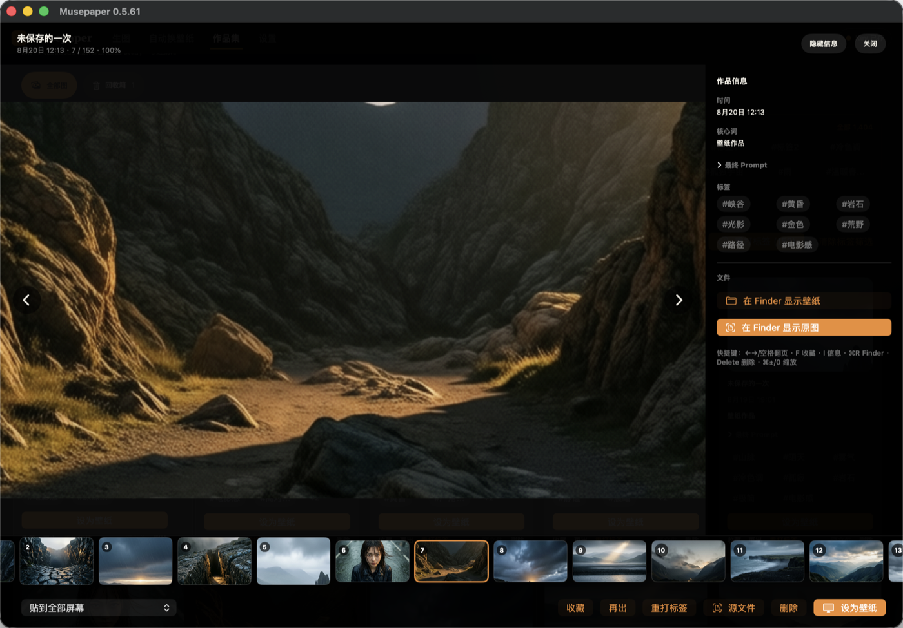

# Musepaper · Interface and demo / 界面与演示

The image is an existing real macOS screenshot with version **0.5.61** visible. It is retained as a historical interface example; the downloadable release is **0.5.63**. No personal paths or credentials are visible in this image. The current release supports English/Chinese switching.

该图片是已公开的真实 macOS 历史截图，窗口版本为 **0.5.61**；当前下载版本为 **0.5.63**，支持中英文切换。画面未显示个人路径或账号凭据。

A current native Computer Use operation video is pending: this session exposes browser control only. We have not substituted a mock desktop or screenshot slideshow for native operation footage. The offline Demo can be tried from the creation page without model credentials.

当前原生 Computer Use 操作视频待补：本会话只开放浏览器控制。未用模拟桌面或截图幻灯片冒充原生操作录像。可从生成页使用离线 Demo，无需模型 Key。
